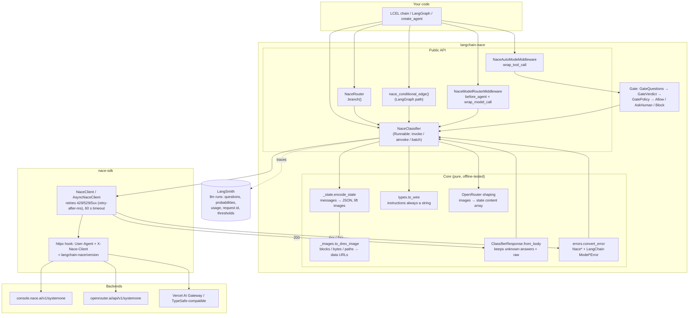
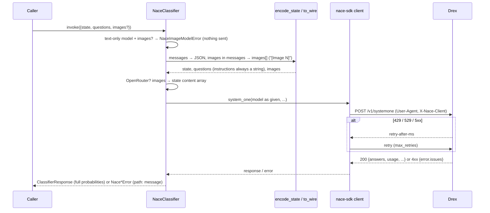
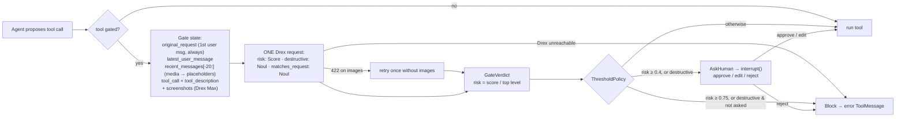
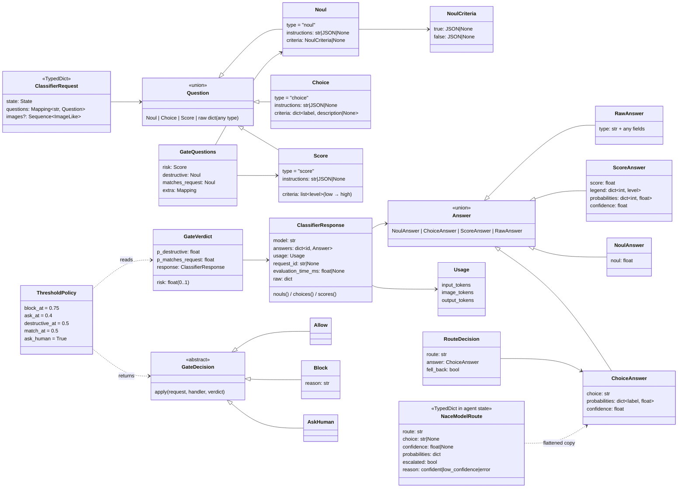

# langchain-nace design

Reference implementations: `langchain-typesafe` (Jev) and `langchain-openai` decisions middleware.

## Principles

- **No model enum.** Any model id is sent exactly as given, so new Drex releases work without a package release. The only model facts in the code are about released, pinned versions, which never change: `drex-v1.5` and `drex-v2.0` read text only, so images sent to them are refused before sending.
- **Drex is the authority on limits.** Question counts, sizes and image rules are enforced by the server; its 422 is shown with each issue's `path: message`.
- **Forward compatible.** Unknown question types (raw dicts), unknown answer types (`RawAnswer`), new response fields (`.raw`) and new request fields (`model_kwargs`) pass through.
- **Never drop data silently.** The classifier raises on images it can't send. Middleware replaces unreadable media with placeholders, so a photo in the chat doesn't stop an agent.
- **Fail safe.** The tool gate blocks when Drex can't be reached; the model router escalates to the strongest model.
- **Same shape as Jev's package.** Same type names, LangChain `Model*Error` hierarchy, error messages without user data, `omit_payload` trace policy on middleware.

## System design

### One `invoke`

### Tool gate

## Data model

### Wire format (what reaches Drex)

| Field | Sent as |
|---|---|
| `model` | exactly as given (default `drex-max`, chosen by product and moved to the newest flagship each release) |
| `state` | string, or JSON; messages as `{role, content}`; images replaced by `"[Image N]"` |
| `questions.<id>` | `{type, instructions: str, criteria}`; JSON instructions/criteria become JSON text |
| `images` | base64 / data URL / `{type: workspace_file, ...}`; explicit images first, then images from messages |
| OpenRouter | no `images`; `state` = `[{type: text}, {type: image_url, image_url: {url: data:...}}...]` |
| headers | `User-Agent`, `X-Nace-Client` = `langchain-nace/<version>`; OpenRouter also `HTTP-Referer`, `X-OpenRouter-Title` |
